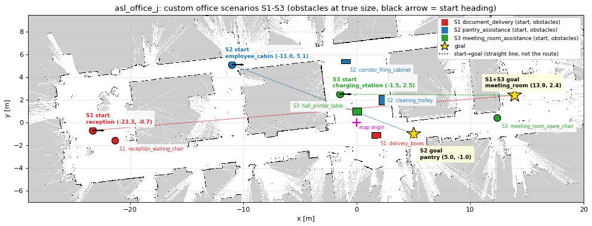

# Custom Office Scenarios 1–3: Integration and Validation

## 1. Project overview

**NavRep – Robot Navigation and Simulation: Office Assistance Robot.** A simulated Pepper robot
(NavRep `MarkEnv` wrapped around the Pepper 2D simulator `PepperRLEnv`) performs three office tasks. Each task has a fixed
start, a fixed goal and static office obstacles. The original NavRep code, maps and simulator are unchanged. The office layer is:

| Layer | File | Role |
|---|---|---|
| Scenarios (Member 3) | `navrep/envs/office_scenarios.py` | locations, start/goal per scenario, map validation |
| Obstacles (Member 4) | `navrep/envs/office_obstacles.py` | obstacles per scenario, validation, augmented map copy |
| Environment | `navrep/envs/officeenv.py` | `OfficeScenarioEnv(MarkEnv)`: fixed start/goal, loads the obstacle map |
| Launcher | `navrep/scripts/play_office_scenario.py` | `--list`, `--check`, `--headless`, interactive viewer |

Details: `docs/member3_start_goal_navigation.md` and `docs/member4_obstacle_configuration.md`.

## 2. Map selection

**`asl_office_j`** (0.02 m/pixel, 54.7 × 25.6 m, origin (-32.16, -11.52)) is a mapped office floor. It has a corridor loop,
a west lobby, a central hall and an east corridor. It is already used by NavRep. `openlab_office_j` was rejected
because its map origin (0, 0) lies outside the building, and the simulator grows its reachable space from (0, 0).
The map has **no room labels**, so the office roles are assigned to verified open areas.

## 3. Scenarios



| # | Scenario | Start (x, y, θ) | Goal (x, y) | Route without / with obstacles |
|---|---|---|---|---|
| S1 | `document_delivery` | Reception (-23.3, -0.7, 0) | Meeting Room (13.9, 2.4) | 41.1 / 41.4 m |
| S2 | `pantry_assistance` | Employee Cabin (-11.0, 5.1, 0) | Pantry (5.0, -1.0) | 21.1 / 23.9 m |
| S3 | `meeting_room_assistance` | Charging Station (-1.5, 2.5, 0) | Meeting Room (13.9, 2.4) | 19.2 / 20.0 m |

θ = 0 means facing +x (east). The route lengths are approximate shortest paths with 0.5 m robot clearance, from the validator.
The goal counts as reached when the robot centre is within 0.5 m of it (simulator rule: radius 0.3 + padding 0.2).

### Obstacles (each scenario uses only its own)

| Scenario | Obstacle | Type | Shape / size [m] | Centre (x, y) |
|---|---|---|---|---|
| S1 | `reception_waiting_chair` | chair | circle, r 0.30 | (-21.3, -1.6) |
| S1 | `delivery_boxes` | box | rect 0.80 × 0.50 | (1.7, -1.1) |
| S2 | `corridor_filing_cabinet` | cabinet | rect 0.80 × 0.40 | (-1.0, 5.4) |
| S2 | `cleaning_trolley` | trolley | rect 0.50 × 0.80 | (2.2, 2.0) |
| S3 | `hall_printer_table` | table | rect 0.80 × 0.60 | (0.0, 1.0) |
| S3 | `meeting_room_spare_chair` | chair | circle, r 0.30 | (12.4, 0.4) |

Every obstacle lies on its scenario's shortest obstacle-free route, so the robot has to go around it. A route with 0.5 m
clearance always remains. Every obstacle edge is ≥ 1.0 m from the start and the goal.
No coordinates were changed in this integration step.

## 4. How the obstacle map copies are generated

The Pepper simulator has **no API for adding obstacles**. It reads the occupancy map once, in `PepperRLEnv.__init__`,
and builds the LiDAR raytracer, the collision distance grid and the reachable space from it. With obstacles enabled,
`OfficeScenarioEnv._make_env()` does the following:

1. It validates the obstacles against the original map from the simulator's map package. If anything is invalid, it raises `ValueError` **before** writing files or building the simulator.
2. `write_augmented_map()` reads `asl_office_j.pgm/.yaml` and paints the obstacle cells as 0 (occupied). It writes
   `asl_office_j_with_obstacles.pgm/.yaml` into a **new** folder `<system temp>/navrep_office_obstacles_XXXX/`.
   Writing over the original map is refused.
3. It builds `PepperRLEnv` with `args.map_folder` and `args.map_name` pointing to that copy. So the obstacles exist **before** the LiDAR and
   collision structures are created, and those structures treat them exactly like walls.
4. `env.close()` deletes that temporary folder. It only deletes folders with the `navrep_office_obstacles_` prefix directly inside the system temp folder.
   Each environment gets its own folder.

With `obstacles="none"` (the default of `OfficeScenarioEnv`) the original `MarkEnv._make_env()` is used unchanged.
The launcher's default is `--obstacles scenario`.

## 5. Launching

Inside the container (repo at `/workspace/navrep`):

```bash
cd /workspace/navrep

# map files only (also work without the simulator; tested on this laptop)
python -m navrep.scripts.play_office_scenario --list
python -m navrep.scripts.play_office_scenario --scenario document_delivery --check
python -m navrep.scripts.play_office_scenario --scenario pantry_assistance --check
python -m navrep.scripts.play_office_scenario --scenario meeting_room_assistance --check
python -m navrep.scripts.play_office_scenario --scenario document_delivery --check --obstacles none

# headless (simulator, no window)
python -m navrep.scripts.play_office_scenario --scenario document_delivery --headless --steps 20
python -m navrep.scripts.play_office_scenario --scenario pantry_assistance --headless --steps 20
python -m navrep.scripts.play_office_scenario --scenario meeting_room_assistance --headless --steps 20

# interactive viewer: WASD move, Q/E rotate, Shift boost, R reset, ESC exit
python -m navrep.scripts.play_office_scenario --scenario document_delivery
python -m navrep.scripts.play_office_scenario --scenario pantry_assistance
python -m navrep.scripts.play_office_scenario --scenario meeting_room_assistance
```

**Disable obstacles:** add `--obstacles none` to any command, or use `OfficeScenarioEnv(scenario=..., obstacles="none")`.
**Original random NavRep behaviour:** `python -m navrep.scripts.play_markenv` (unchanged), or
`OfficeScenarioEnv(map_name="asl_office_j")` (random start and goal on the office map).

## 6. Tests and results

```bash
python -m pytest tests/test_office_scenarios.py tests/test_office_obstacles.py tests/test_office_integration.py -v
```

Run on the Windows laptop (Python 3.12, no simulator, no Docker): **70 passed, 0 failed, 8 skipped.**
The result is the same in both file orders. The Python 3.6 syntax check passes on all office files.

| Category | Files | Result | What it shows |
|---|---|---|---|
| 1. Configuration and map files | `test_office_scenarios.py` (19), `test_office_obstacles.py` (35) | **54 passed** | coordinates, roles, free space and clearance, routes, obstacle rules, invalid inputs rejected, augmented map has occupied cells, original map unchanged (md5), CLI `--list` / `--check` |
| 2. Simulator stand-in | `test_office_integration.py` (16) | **16 passed** | the real `OfficeScenarioEnv` / `MarkEnv` code with a stub `PepperRLEnv` that loads the map named in args at construction. Covers: per-scenario start/goal, its own obstacles only, `none` mode and default, 3 repeated resets, simulator built once, random mode, invalid poses and obstacles rejected before the simulator is built (no temp leak), temp map removed on close, separate temp folder per env, `--headless` CLI including `--steps 0` |
| 3. Real NavRep simulator | 4 tests in each of the first two files | **8 skipped (not run)** | needs `pepper_2d_simulator` (Docker). **Nothing about the real simulator is claimed.** |

Fixes made during this integration, found by code review and covered by new tests:
- `--headless --steps 0` crashed (`NameError`). The headless mode now also resets explicitly and prints the loaded map and active obstacles.
- Temporary obstacle maps (about 3.5 MB each) were never deleted. `OfficeScenarioEnv.close()` now removes them.
- `reset(set_scenario=<other map>)` with obstacles enabled silently ignored the request. It now raises `ValueError`.

## 7. Limitations

- Office roles are labels assigned to an unlabelled map. Room interiors are unmapped and cannot be entered.
- Obstacles are static circles or axis-aligned rectangles. Moving obstacles are not supported by `PepperRLEnv`.
- There is no autonomous planner or policy. The viewer is keyboard teleoperation (as in `play_markenv.py`). The validator only proves that a collision-free route **exists**.
- **Interactive rendering has not been verified:** `MarkEnv.render()` passes `save_to_file=` to `PepperRLEnv.render()`, and the upstream simulator does not accept it. If `play_markenv.py` fails with that `TypeError`, the interactive mode fails too. `--headless` does not render.
- Building `PepperRLEnv` on this map (TSDF, raytracer) may be heavy for 8 GB of RAM.
- If the process is killed instead of closed, its temp map folder stays in the system temp folder. It is safe to delete `navrep_office_obstacles_*` folders there.

## 8. Must be tested in the Docker container

1. `python -m pytest tests/test_office_scenarios.py tests/test_office_obstacles.py tests/test_office_integration.py -v`.
   Expected: the 8 previously skipped tests now **run and pass** (real map loading, obstacle cells occupied in `rlenv.map2d`, start and goal placement).
2. `--headless --steps 20` for all three scenarios. Expect `simulator map: asl_office_j_with_obstacles`, the start pose printed, `damage 0.0`, and scan shape `(1080,)`.
3. The interactive viewer for all three scenarios (section 9). Confirm the obstacles are drawn, appear in the LiDAR, and stop the robot on contact.
4. After closing, `ls /tmp | grep navrep_office_obstacles_` should print nothing.

## 9. Video recording checklist (for the teammate with Docker and a stronger computer)

Record the simulator window with OBS (*Window Capture*) or Win + Alt + R on Windows/WSLg, or with
`ffmpeg -video_size 1280x720 -framerate 25 -f x11grab -i $DISPLAY -c:v libx264 -pix_fmt yuv420p <file>.mp4` on X11.
First run the `--check` command and the `--headless` command for the scenario, and keep that terminal output as evidence.

| | `document_delivery.mp4` | `pantry_assistance.mp4` | `meeting_room_assistance.mp4` |
|---|---|---|---|
| Command | `python -m navrep.scripts.play_office_scenario --scenario document_delivery` | `... --scenario pantry_assistance` | `... --scenario meeting_room_assistance` |
| Visible at start | robot at the west lobby (-23.3, -0.7) facing east, goal marker at the east corridor (13.9, 2.4), waiting chair and delivery boxes | robot in the north corridor (-11.0, 5.1), goal at the south corridor (5.0, -1.0), filing cabinet and cleaning trolley | robot in the central hall (-1.5, 2.5), goal at the east corridor (13.9, 2.4), printer table and spare chair |
| Behaviour to show | leave the lobby past the chair, take the south corridor, go around the boxes, reach the meeting room | go along the north corridor past the cabinet, through the hall around the trolley, reach the pantry | go around the printer table, along the south corridor, around the spare chair, reach the meeting room |
| Also show (optional) | press R: the robot returns to the same start | the same | the same |
| Evidence to capture | terminal: `simulator map: asl_office_j_with_obstacles`, `active obstacles: ...`, and the final `episode_statistics` table with `goal_reached True`. Optionally a short clip of bumping an obstacle (episode ends with `collisioned_out True`) | the same | the same |

Rules: record a **real** run only, and do not edit the result. If the viewer fails (for example the `save_to_file` `TypeError`), record
the terminal output of the `--headless` run instead and report the failure rather than presenting the scenario as working.
Goal arrival ends the episode and the viewer resets to the start. That reset, together with `goal_reached True` in the printed
statistics, is the evidence of success.
