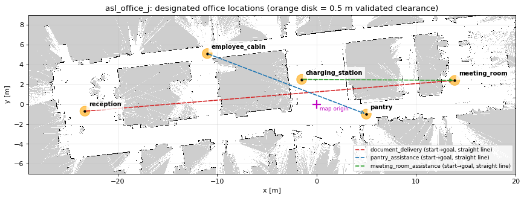

# Member 3: Start and Goal Position Configuration (Office Assistance Robot)

## 1. Files inspected

| File | Location | Purpose |
|---|---|---|
| `navrep/envs/markenv.py` | this repo | `MarkEnv` gym wrapper around `PepperRLEnv` |
| `navrep/envs/scenario_list.py` | this repo | named "iros"/"rl" scenarios: these select only a **map**, not positions |
| `navrep/scripts/play_markenv.py` | this repo | interactive launcher (`EnvPlayer(MarkEnv())`) |
| `navrep/tools/envplayer.py` | this repo | keyboard teleoperation loop, calls `env.reset/step/render` |
| `pepper_2d_simulator.py` | **not in this repo**. Container: `/root/Code/interaction_actions_for_navigation/external/asl_pepper/asl_pepper_2d_simulator/python/pepper_2d_simulator.py` (see `setup/patches/pepper_2d_simulator_dtype.patch`) | `PepperRLEnv`, `Virtual2DPepper` |
| `setup/patches/pepper_2d_simulator_dtype.patch` | this repo | confirms the simulator path and version used in the container |
| `maps/asl_office_j.{pgm,yaml}`, `maps/openlab_office_j.{pgm,yaml}` | this repo | candidate office maps |
| `docs/member2_robot_configuration.md`, `README_SETUP.md` | this repo | robot parameters, container setup |

The simulator was read from the upstream repository
`ethz-asl/interaction_actions_for_navigation` (commit `e38ca94`, 2021-06-10). Line numbers below refer
to that file. The container's copy differs only by the dtype patch. Its `asl_office_j.pgm` is byte-identical
to `maps/asl_office_j.pgm` in this repo.

## 2. How the original start/goal mechanism works

| Question | Answer (verified in source) |
|---|---|
| Where is the initial position generated? | `PepperRLEnv._respawn_agents()` (l. 756): a random point from `self.reachable_xy`, random heading `th = rand()*2π`. Unless `--deterministic` (always `(0,0,0)`) or `--circular-scenario` is set. |
| Where is the goal generated? | `PepperRLEnv.sample_goal(i)` (l. 861): random point of `reachable_xy` at least `kMinSampleGoalDist = 3 m` from the robot, random heading. With `--deterministic`, `DETERMINISTIC_GOAL = (0, 5.5, 0)`. |
| How are random starts selected? | `_reset_agents()` (l. 725) calls `_respawn_agents()` then `sample_goal()`. `PepperRLEnv.reset()` (l. 818) = `_reset_agents()` + `step(None)`. `MarkEnv.reset()` calls `rlenv.reset(ONLY_FOR_AGENT_0=True)`. `MarkEnv._make_env()` picks the map at random from `self.maps`. |
| How is reachability checked? | In `PepperRLEnv.__init__` (l. 676-681): the map is coarsened 3× (8× resolution), obstacles are inflated by `kRobotRadius + 0.2 = 0.5 m`, and `coarse.dijkstra()` runs **from the map origin (0, 0)**. Cells with distance < 10000 form `reachable_space` / `reachable_xy`. Starts and goals are only sampled from those cells. |
| How does the robot receive actions? | `MarkEnv.step(action)` → `PepperRLEnv.step(action.reshape(1,3))` → `normalized_to_cmd_vel()` (action in [-1,1]³ × `kMaxVel`) → `Virtual2DPepper.set_cmd_vel()` / `odom_update(dt)`. `MarkEnv` sets `NO_INERTIA = True`. |
| How is goal arrival decided? | `PepperRLEnv.step()` (l. 1392): `‖pos_xy − goal_xy‖ < robot_radius (0.3) + GOAL_REACHED_PADDING (0.2)`, i.e. within 0.5 m. Goal heading is ignored. `MarkEnv.step()` then sets `done=True` (also on timeout `max_episode_length` or any collision damage). |
| Can start/goal be configured externally? | **No.** No CLI argument or `MarkEnv` parameter for coordinates exists. `--deterministic` only gives the hard-coded `(0,0)` → `(0,5.5)`. `scenario_list.set_scenario()` only selects a map. |
| Reusable functions | `PepperRLEnv._set_agents_pos(list_of_poses)` (l. 713), `PepperRLEnv._set_agents_goals(list_of_goals)` (l. 720), `_reset_agents()`, `step(None)` (observation without motion), `MarkEnv._make_env()`, `MarkEnv.step()`, `EnvPlayer`. |

## 3. Map selection

| Map | Size | Origin (0,0) | Verdict |
|---|---|---|---|
| `asl_office_j` | 54.7 × 25.6 m, 0.02 m/px | inside the central hall (1.2 m clearance) | **Selected.** Office floor with a corridor loop, a west lobby, a central hall and an east corridor. Already used by NavRep (`irosasl_office_j*`). |
| `openlab_office_j` | 32 × 69.8 m, 0.02 m/px | in **unknown space outside the building** | **Rejected.** `PepperRLEnv` seeds its reachable space at (0,0), so reachable space would not be the mapped office interior. |

**Limitation:** the occupancy map has **no semantic labels**, and the room interiors (grey) were not mapped, so the robot cannot enter them.
"Reception", "Pantry" and the other places are therefore *designated* open areas, chosen so that their
roles are plausible. They are not real rooms identified in the map.

## 4. Files created / modified

**No existing file was modified.** `MarkEnv`, `scenario_list.py`, `play_markenv.py` and the simulator are unchanged.

| New file | Purpose |
|---|---|
| `navrep/envs/office_scenarios.py` | Locations, the three scenarios, and map-based validation (free cell, clearance, path to goal, connection to origin). Imports only numpy, Pillow and PyYAML, so no simulator is needed. |
| `navrep/envs/officeenv.py` | `OfficeScenarioEnv(MarkEnv)`. Overrides only `reset()` to place the robot and goal. |
| `navrep/scripts/play_office_scenario.py` | Launcher: `--scenario`, `--list`, `--check`, `--headless`. |
| `tests/test_office_scenarios.py` | 19 lightweight tests plus 4 simulator tests (auto-skipped without the simulator). |
| `docs/member3_start_goal_navigation.md`, `docs/member3_office_scenarios_map.png` | This document and the location figure. |

## 5. Implementation details

`OfficeScenarioEnv.reset()` reproduces `MarkEnv.reset()`, with `PepperRLEnv.reset()` inlined so the pose
override happens **before** the first observation is computed:

```python
self.rlenv._reset_agents()                          # original random spawn + goal, resets counters/buffers
self.rlenv._set_agents_pos([self.start_pose])       # existing simulator helper: vp.reset(); vp.pos = pose
self.rlenv._set_agents_goals([self.goal_pose])      # existing simulator helper
obs, _, _, _ = self.rlenv.step(None, ONLY_FOR_AGENT_0=True)   # same as PepperRLEnv.reset()
```

- **Orientation**: `pos = [x, y, θ]` is supported by the simulator. The start heading comes from `start_yaw` in the scenario.
- **Random mode preserved**: `OfficeScenarioEnv(map_name=...)` without start or goal just calls `MarkEnv.reset()`. `MarkEnv` itself is unchanged.
- **Custom poses**: `OfficeScenarioEnv(map_name="asl_office_j", start_pose=[x, y, th], goal_pose=[x, y])`.
- **Validation** runs once, on the first reset, against the map file the simulator actually loaded (`rlenv.args.map_folder`). An invalid pose raises `ValueError`. It also prints a warning if a pose is more than 0.3 m from the simulator's own `reachable_xy`.
- **API guard**: if the installed simulator lacks `_reset_agents`, `_set_agents_pos` or `_set_agents_goals`, a clear `AttributeError` is raised.
- After the goal is reached, the simulator internally resamples a random goal, but `MarkEnv` returns `done=True`. The next `reset()` restores the configured start and goal.

## 6. Coordinates and how they were verified

Frame: `asl_office_j` map frame (metres). Pixel → world: `x = origin_x + (col + 0.5)·0.02`,
`y = origin_y + (H − 1 − row + 0.5)·0.02`, with origin `(-32.16, -11.52)` taken from `asl_office_j.yaml`.

| Location | x [m] | y [m] | Area | Measured clearance |
|---|---:|---:|---|---:|
| reception | -23.3 | -0.7 | west lobby | ≥ 1.50 m |
| meeting_room | 13.9 | 2.4 | east corridor by the east room block | ≥ 0.90 m |
| employee_cabin | -11.0 | 5.1 | north corridor, north-west office row | ≥ 0.70 m |
| pantry | 5.0 | -1.0 | south corridor, east of central hall | ≥ 1.00 m |
| charging_station | -1.5 | 2.5 | central hall, west side | ≥ 0.95 m |

| Scenario | Start → Goal | start θ | Approx. path length |
|---|---|---:|---:|
| `document_delivery` | reception → meeting_room | 0 rad | 41.1 m |
| `pantry_assistance` | employee_cabin → pantry | 0 rad | 21.1 m |
| `meeting_room_assistance` | charging_station → meeting_room | 0 rad | 19.2 m |

Verification procedure (repeatable with `--check` and the tests):
1. Cells are counted as free only if occupancy < `free_thresh` (0.15). Unknown (grey, 205) and occupied cells are both treated as blocked, which is stricter than the simulator.
2. Every cell within **0.5 m** (robot radius 0.3 + the simulator's 0.2 margin) must be free.
3. Start → goal path search on a 0.1 m grid in which a cell is blocked if *any* sub-pixel is not free, then inflated by 0.5 m. It also checks that the start connects to the map origin, which seeds the simulator's reachable space.
4. Two eyeballed candidates (meeting room `(13.6, 3)`, pantry `(6, -1.5)`) and a first employee-cabin point `(-11.9, 3.7)` **failed** these checks and were replaced.

Max speed is 0.55 m/s (member 2 doc), so the longest route (41 m) needs ≥ 75 s ≈ 150 steps at `dt = 0.5 s`. This is well within `max_episode_length = 1000`.



*(Straight dashed lines only connect start and goal. Real routes follow the corridors.)*

## 7. Commands

Inside the container (repo mounted at `/workspace/navrep`):

```bash
docker exec -it <container_name> bash        # find the name with: docker ps
cd /workspace/navrep

# no simulator needed
python -m navrep.scripts.play_office_scenario --list
python -m navrep.scripts.play_office_scenario --scenario document_delivery --check
python -m navrep.scripts.play_office_scenario --scenario pantry_assistance --check
python -m navrep.scripts.play_office_scenario --scenario meeting_room_assistance --check

# simulator, no window (light): prints pose after reset, steps with zero action
python -m navrep.scripts.play_office_scenario --scenario document_delivery --headless --steps 20

# interactive viewer (needs a display): WASD move, Q/E rotate, R reset, ESC exit
python -m navrep.scripts.play_office_scenario --scenario document_delivery
python -m navrep.scripts.play_office_scenario --scenario pantry_assistance
python -m navrep.scripts.play_office_scenario --scenario meeting_room_assistance

# tests (simulator tests run automatically when pepper_2d_simulator is importable)
python -m pytest tests/test_office_scenarios.py -v
```

Python API:

```python
from navrep.envs.officeenv import OfficeScenarioEnv
env = OfficeScenarioEnv(scenario="document_delivery")
obs = env.reset()     # robot at reception, goal at meeting room
```

## 8. Testing

**Executed** (Windows host, Python 3.12, no simulator):
- `py_compile` on all new files: OK. `ast.parse(..., feature_version=(3, 6))`: OK (Python 3.6 syntax).
- `pytest tests/test_office_scenarios.py`: **19 passed, 4 skipped** (the skipped tests need the simulator). Covered: scenario definitions, map metadata, every location free with 0.5 m clearance, start→goal reachability, rejection of outside, unknown, occupied and too-close-to-wall points, and the `--list` / `--check` CLI.
- `OfficeScenarioEnv` was exercised against a **stub** `pepper_2d_simulator` that copies the upstream method signatures (not committed). Checked: start and goal set on every reset, call order `_reset_agents → step(None)`, goal vector in the observation is consistent, random mode still random, invalid pose rejected. This checks the wrapper logic only, **not** the real simulator.

**Not executed: needs the Docker container or a stronger machine:**
- The 4 simulator tests in `tests/test_office_scenarios.py` (real `PepperRLEnv`, map loading, TSDF and Dijkstra on `asl_office_j`).
- `--headless` and interactive runs of all three scenarios.
- Driving each route to the goal and confirming `goal_reached=True` in `env.episode_statistics`.

## 9. Known limitations

- Office roles are designated labels on an unlabelled map. The robot cannot enter the unmapped room interiors.
- **Rendering compatibility not verified:** `MarkEnv.render()` forwards `save_to_file=` to `PepperRLEnv.render()`, but upstream `PepperRLEnv.render()` (l. 1570) has no such parameter. If `play_markenv.py` fails with `TypeError: ... 'save_to_file'`, the interactive mode of this launcher fails the same way (it uses the same `EnvPlayer`). `--headless` does not render. Check with `grep -n "def render" <simulator path>`.
- No autonomous planner/policy is attached. The interactive mode is keyboard teleoperation, like `play_markenv.py`. Trained NavRep policies were trained on random start/goal on other maps, and running them here is out of scope.
- The simulator constructs `PepperRLEnv` on a 2736 × 1280 map (TSDF + Dijkstra). This may be slow or memory-heavy on an 8 GB machine.
- `MarkEnv.step` ends the episode on any collision (`episode_damage > 0`).

## 10. Recording simulation videos

Interactive mode opens a pyglet window, so record that window:

- **Windows host (WSLg window)**: OBS Studio → *Window Capture* → select the simulator window, or press `Win + Alt + R` (Xbox Game Bar).
- **Inside Linux/X11** (if `ffmpeg` is installed and `DISPLAY` is set):
  ```bash
  ffmpeg -video_size 1280x720 -framerate 25 -f x11grab -i $DISPLAY -c:v libx264 -pix_fmt yuv420p document_delivery.mp4
  ```
  Start the recorder, then run the scenario in another terminal. Press `q` in ffmpeg to stop.
- Record one video per scenario. Show the start position briefly before driving, then drive to the goal until the episode resets (that is goal reached). Afterwards the launcher prints `episode_statistics` with `goal_reached`; include that output.
