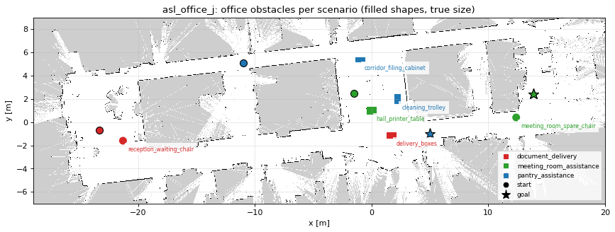

# Member 4: Obstacle Configuration (Office Assistance Robot)

## 1. How NavRep originally handles obstacles

Source: `pepper_2d_simulator.py` (upstream `ethz-asl/interaction_actions_for_navigation`, commit `e38ca94`,
the same file as in the container apart from the dtype patch) and `pymap2d` 0.1.15 (`CMap2D.pyx`, the version installed in the container).

| Aspect | Original behaviour |
|---|---|
| Static obstacles | **Only** occupied cells of the occupancy map. `CMap2D(folder, name)` loads `<name>.yaml` plus the image with `occupancy = 1 − pixel/254`. A cell is occupied if `occupancy ≥ occupied_thresh` (0.65). |
| When obstacles are read | **Once**, in `PepperRLEnv.__init__`: `Raytracer` (range_libc `PyOMap` of occupied cells), `self.tsdf = map2d.as_tsdf(0.6)` (collision), coarse map plus Dijkstra from (0, 0) (reachable space for random starts and goals). Nothing is updated later. |
| Dynamic obstacles | Only other Pepper agents (`n_agents > 1`), rendered into the LiDAR as two legs (`CSimAgent`, `render_agents_in_many_lidars`) and checked for agent-agent collision. `MarkEnv` hard-codes `n_agents = 1`, so there are **none**. No pedestrians or moving objects. |
| Robot radius | `kRobotRadius = 0.3 m` |
| Collision | `tsdf[robot cell] < 0.3` → damage. In `BOUNCE` mode the robot is pushed back. `MarkEnv` ends the episode on any damage. |
| Inflation | Reachable space: obstacles inflated by 0.5 m on the 8× coarse map. |
| Obstacle API / config | **None.** No `add_obstacle` function, no obstacle file format, no CLI option. |

Obstacles already in `asl_office_j`: walls and room-block outlines, plus pillar and furniture blobs in the central hall.
Together these are about 31,000 occupied pixels.

**Conclusion:** obstacles can only be added through the occupancy map, and only before `PepperRLEnv` is built.
The one supported entry point is the map loader (`args.map_folder`, `args.map_name`).

## 2. Implemented approach

1. Obstacles are **defined per scenario** in `navrep/envs/office_obstacles.py`, separate from NavRep code.
2. They are **validated** against the original map (section 5).
3. `write_augmented_map()` paints them (pixel value 0 = occupied) into a **copy** of the map
   (`asl_office_j_with_obstacles.pgm/.yaml`) in a new temporary folder. **The original map is never written.**
4. `OfficeScenarioEnv(..., obstacles="scenario")` overrides `_make_env()`. It is identical to `MarkEnv._make_env()`
   except that `args.map_folder` and `args.map_name` point to the copy. The simulator then builds its LiDAR raytracer, collision TSDF,
   reachable space and viewer from the copy, so the obstacles are treated exactly like walls.
5. `obstacles="none"` (the **default** of `OfficeScenarioEnv`) keeps Member 3's behaviour: the original map is used and `MarkEnv._make_env()` is unchanged.

The obstacles are static. Moving obstacles would need simulator changes, which are not implemented.

## 3. Obstacle configurations

Frame: `asl_office_j` map frame [m]. Circle = radius, rect = width (x) × height (y), axis-aligned, centred on (x, y).
"Distance" is from the start or goal point to the obstacle's edge.

| Scenario | Obstacle | Type | Shape / size | Centre (x, y) | Dist. start / goal | On route? | Why there |
|---|---|---|---|---|---:|---|---|
| document_delivery | `reception_waiting_chair` | chair | circle r 0.30 | (-21.3, -1.6) | 1.89 / 35.13 m | yes | waiting chair in the reception lobby, on the way out of the lobby |
| document_delivery | `delivery_boxes` | box | rect 0.80 × 0.50 | (1.7, -1.1) | 24.60 / 12.24 m | yes | parcels left in the wider part of the south corridor |
| pantry_assistance | `corridor_filing_cabinet` | cabinet | rect 0.80 × 0.40 | (-1.0, 5.4) | 9.60 / 8.35 m | yes | cabinet in the north corridor where it opens into the central hall |
| pantry_assistance | `cleaning_trolley` | trolley | rect 0.50 × 0.80 | (2.2, 2.0) | 13.23 / 3.64 m | yes | trolley parked in the central hall on the way to the pantry |
| meeting_room_assistance | `hall_printer_table` | table | rect 0.80 × 0.60 | (0.0, 1.0) | 1.63 / 13.54 m | yes | printer table in the central hall next to the charging station |
| meeting_room_assistance | `meeting_room_spare_chair` | chair | circle r 0.30 | (12.4, 0.4) | 13.76 / 2.20 m | yes | spare chair left at the meeting-room approach |

Approximate shortest route with 0.5 m robot clearance (8-connected search on a 0.1 m grid):

| Scenario | Without obstacles | With obstacles |
|---|---:|---:|
| document_delivery | 41.1 m | 41.4 m |
| pantry_assistance | 21.1 m | 23.9 m |
| meeting_room_assistance | 19.2 m | 20.0 m |

"On route" means that this obstacle alone makes the shortest obstacle-free route longer, so the robot has to go around it.
A route with 0.5 m clearance still exists in every scenario (the "with obstacles" column).
The positions were found by tracing the actual route and testing candidates. Three first candidates were valid
but not on the route (the chair at (-21.3, -1.0), the cabinet at (-1.0, 6.6), and others), so they were moved.



Start and goal coordinates from Member 3 are **unchanged** (this is covered by a test).

## 4. Validation rules (`validate_obstacles`)

1. Unique non-empty `name`. `type` is one of `chair, table, cabinet, box, trolley, bin, plant`. `shape` is `circle` or `rect`.
2. `x`, `y` and the dimensions are finite numbers, and the dimensions are > 0.
3. The whole footprint is inside the map.
4. The footprint covers only free cells: no walls, existing obstacles or unknown space.
5. The edge is ≥ **1.0 m** from both the start and the goal (robot radius 0.3 + goal radius 0.2 + 0.5 margin).
6. Obstacles are ≥ **0.1 m** apart (edge to edge).
7. After adding all obstacles: start and goal still have 0.5 m clearance, a start → goal route with 0.5 m clearance exists,
   and the start is still connected to the map origin (the seed of the simulator's reachable space).

`OfficeScenarioEnv` runs these checks before building the simulator and raises `ValueError` if any fails.

## 5. Files

| File | Status |
|---|---|
| `navrep/envs/office_obstacles.py` | **new**: config, geometry, validation, augmented-map writer |
| `tests/test_office_obstacles.py` | **new**: 35 lightweight tests plus 4 simulator tests |
| `docs/member4_obstacle_configuration.md`, `docs/member4_obstacles_map.png` | **new** |
| `navrep/envs/officeenv.py` (Member 3) | **modified**: `obstacles=` parameter (default `"none"`), `_make_env()` override, `_validate_poses()` now reads the map that was actually loaded |
| `navrep/scripts/play_office_scenario.py` (Member 3) | **modified**: `--obstacles scenario\|none` (default `scenario`). `--list` and `--check` show and validate obstacles |

Original NavRep files (`markenv.py`, `scenario_list.py`, the maps, the simulator) are **not modified**.

## 6. Commands

```bash
cd /workspace/navrep    # or the repo root on any machine with numpy, Pillow, PyYAML, pytest

# lightweight (no simulator)
python -m pytest tests/test_office_obstacles.py tests/test_office_scenarios.py -v
python -m navrep.scripts.play_office_scenario --list
python -m navrep.scripts.play_office_scenario --scenario document_delivery --check
python -m navrep.scripts.play_office_scenario --scenario document_delivery --check --obstacles none

# simulator (Docker container)
python -m navrep.scripts.play_office_scenario --scenario document_delivery --headless --steps 20
python -m navrep.scripts.play_office_scenario --scenario document_delivery                    # with obstacles
python -m navrep.scripts.play_office_scenario --scenario pantry_assistance
python -m navrep.scripts.play_office_scenario --scenario meeting_room_assistance
python -m navrep.scripts.play_office_scenario --scenario document_delivery --obstacles none   # without
```

## 7. Test results

**Executed** (Windows host, Python 3.12, no simulator):
- `pytest tests/test_office_obstacles.py tests/test_office_scenarios.py`: **54 passed, 0 failed, 8 skipped**.
  The 8 skipped tests need `pepper_2d_simulator`. All of Member 3's tests still pass.
- Python 3.6 syntax check (`ast.parse(..., feature_version=(3, 6))`) on all new and changed files: OK.
- `--check` with and without obstacles for all three scenarios: VALID.
- `OfficeScenarioEnv` with a **stub** simulator (not committed): for each scenario, the simulator was built from
  `asl_office_j_with_obstacles` in a separate folder, the obstacle cells were occupied in that file, and the start was restored on reset.
  The default still used `asl_office_j`, and an obstacle placed on the start was rejected. This checks the wrapper logic only.

| Level | Status |
|---|---|
| 1. Obstacles defined in configuration | done, validated |
| 2. Obstacles applied to the simulator's map input | implemented. The map file written is verified; loading it in the real `PepperRLEnv` is **not yet run** |
| 3. Obstacles tested in the real simulation (LiDAR sees them, collision, avoidance) | **not tested**: needs the Docker container |

## 8. Limitations and simulator integration requirements

- **Static only.** Moving obstacles would need simulator changes, such as extra agents or a per-step map update, which `PepperRLEnv` does not support.
- **Axis-aligned rectangles and circles only.** Rotated furniture is not supported.
- **Rasterised at 0.02 m.** Edges are accurate to about one cell.
- **Container checks to run:** the 4 simulator tests in `tests/test_office_obstacles.py` (they confirm `map2d.occupancy()` at each obstacle is ≥ `thresh_occupied`), a `--headless` run, and the interactive viewer to confirm that obstacles appear in the LiDAR and the robot bounces or collides on contact.
- **Temporary files.** Each `OfficeScenarioEnv` with obstacles writes one map copy (about 3.5 MB) to the system temp folder. It is not deleted automatically.
- **Memory.** Building `PepperRLEnv` on `asl_office_j` (TSDF, raytracer) may be heavy on an 8 GB machine, with or without obstacles.
- **Not verified.** The rendering caveat from the Member 3 doc (`save_to_file` argument) still applies to interactive mode.
- **No autonomous avoidance.** No planner or policy is attached. Avoidance is by keyboard teleoperation. The validation only shows that an avoiding route **exists**.
